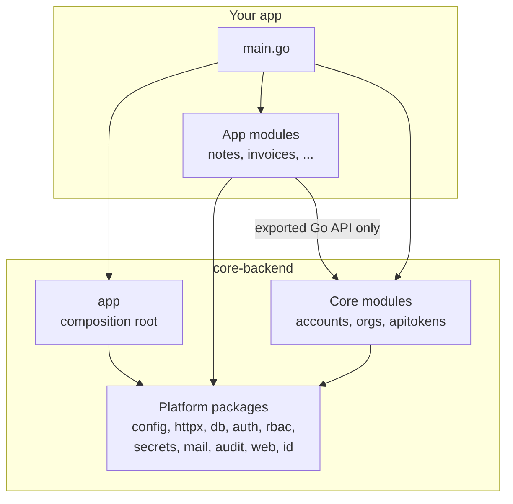

# Backend architecture

How `core-backend` is organized and how an app uses it. For where the app runs, see the topology in
[project/topology.md](project/topology.md). For the tables, see [erd.md](erd.md).

## Layers



Import rules:

| Package kind | May import | Must not import |
|---|---|---|
| Platform packages | standard library, other platform packages, approved dependencies | `app`, any module |
| `app` | platform packages | modules (they are passed in) |
| Core modules | `app`, platform packages, another module's exported API | another module's tables |
| App modules | the same as core modules | core modules' tables |

## Packages

| Package | Responsibility | Key API |
|---|---|---|
| `app` | Connect, migrate, register modules, serve, stop on SIGTERM | `app.Run`, `app.New`, `Registry` |
| `config` | Read `APP_*` environment variables, validate all of them at once, print a redacted summary | `config.Load`, `config.LoadFrom` |
| `httpx` | Router on `net/http.ServeMux`, middleware, strict JSON decoding, problem+json errors | `httpx.Decode`, `httpx.JSON`, `httpx.Error` |
| `db` | `pgx` pool, transactions, per-module migrations | `db.InTx`, `db.Migrate` |
| `db/dbtest` | A fresh database per test, dropped afterwards | `dbtest.URL`, `dbtest.Pool` |
| `auth` | Argon2id passwords, random tokens and their hashes, TOTP and recovery codes, rate limiter | `auth.HashPassword`, `auth.NewToken`, `auth.VerifyTOTP`, `auth.Limiter` |
| `rbac` | Caller identity, permissions, access in one organization | `rbac.Principal`, `rbac.Access`, `rbac.AccessFrom` |
| `secrets` | AES-256-GCM encryption under `APP_MASTER_KEY`, bound to a context string | `secrets.Box.Seal`, `Open` |
| `mail` | SMTP sender; a logging sender for development; an in-memory sender for tests | `mail.Sender` |
| `audit` | Audit events written in the caller's transaction | `audit.Record`, `audit.List` |
| `web` | Serve the React build under `/app/` with CSP nonces and cache headers | `web.SPA` |
| `id` | UUIDv7 | `id.New`, `id.Valid` |
| `api` | The OpenAPI description of the core endpoints | `api.Spec` |
| `apptest` | Run a whole app in tests, with a browser-like client | `apptest.New`, `Server.SignUp` |

*(planned)*: `jobs` (River queue in Postgres), `blob` (S3-compatible storage).

## Modules

A module is a self-contained feature: its own tables, migrations, routes and permissions. Core modules
and app modules use the same contract.

```go
type Module interface {
    // Name is unique, lowercase and stable: it keys the module's migrations.
    Name() string
    // Migrations returns the module's SQL files (NNNN_description.sql), or nil.
    Migrations() fs.FS
    // Permissions lists what roles can grant, for example "notes.read".
    Permissions() []rbac.Permission
    // Register mounts routes, authenticators and periodic tasks.
    Register(r *app.Registry) error
}
```

`Registry` gives a module the shared services (`DB`, `Mail`, `Secrets`, `Limiter`, `Logger`, `Config`)
and the methods to plug in: `Handle`, `Require`, `RequireUser`, `RequireSession`, `AddAuthenticator`,
`SetResolver` and `Every` (periodic tasks).

| Core module | Owns | Provides to other modules |
|---|---|---|
| `accounts` | users, sessions, two-factor, one-time tokens | session authenticator, `GetUser`, `GetUsers`, `IsActive`, `UserIDByEmail`, `OnSignUp` and `OnPasswordReset` hooks |
| `orgs` | organizations, roles, memberships, invitations | the permission resolver, `IsMember`, the audit log endpoint |
| `apitokens` | API tokens | bearer-token authenticator; revokes a user's tokens on password reset |

### Talking between modules

- Call another module's exported Go API (`orgs.IsMember(ctx, q, orgID, userID)`). Never query its tables.
  Foreign keys to `users` and `organizations` are allowed; they keep the data consistent.
- For reactions to events, the owning module exposes a hook that runs inside its transaction, so
  either everything commits or nothing does. Example: `accounts.OnSignUp`, which `orgs` uses to place
  a new user in an organization.

## Request flow

```mermaid
sequenceDiagram
    participant B as Browser
    participant M as Middleware
    participant R as Require (orgs resolver)
    participant H as Handler (module)
    participant D as Postgres

    B->>M: POST /api/v1/orgs/{org}/notes (cookie, X-CSRF-Token)
    M->>M: request ID, panic recovery, access log, security headers and CSP nonce
    M->>D: session by token hash (or API token by hash)
    M->>M: Origin / Sec-Fetch-Site check, CSRF token check
    M->>R: Require("notes.write")
    R->>D: membership and role in {org}
    R-->>M: 404 if not a member, 403 without the permission
    R->>H: request with rbac.Access in context
    H->>D: BEGIN; insert note with org_id; audit event; COMMIT
    H-->>B: 201 Created, JSON body
```

Failures return `application/problem+json` with a stable `type`, a human `title`, and, for 500s, the
request ID. Internal errors are logged with detail and never sent to the client.

## Tenancy and access

- `APP_TENANCY=single`: the first sign-up creates the organization; later sign-ups join it as members
  (or with the role of their invitation). `multi`: each sign-up without an invitation gets an
  organization of their own, and users can create more.
- Every row that belongs to an organization has `org_id`, and every query on it filters by `org_id`.
- The caller is a **user** (session cookie) or an **API token**. Both resolve to permissions in one
  organization through the `orgs` resolver:
  - owner and admin: every permission declared by any module;
  - member: the permissions declared with `Member: true`;
  - custom roles: the permissions stored for the role;
  - API tokens: the token's permissions intersected with what its creator has now.
- Handlers check permissions through `Registry.Require`, never by role name.
- A request for another organization returns 404, not 403, so IDs do not leak.
- Nobody can grant permissions they do not have: custom roles, role changes, invitations and API tokens
  are all limited to the caller's own permissions. Only owners can make or change owners, and the last
  owner cannot leave.
- Account settings (password, two-factor, sessions, API tokens) accept browser sessions only, so a leaked
  API token cannot take over the account.
- Postgres row-level security is not used. It may be added later as a second layer.

## Security defaults

| Concern | Default |
|---|---|
| Passwords | Argon2id (19 MiB, 2 passes), 12 to 256 characters, common passwords and the email rejected, rehash when parameters change |
| Sessions | 256-bit random token in an `HttpOnly`, `SameSite=Lax` cookie (`__Host-` prefixed and `Secure` over https); only its SHA-256 is stored; idle and absolute expiry |
| CSRF | Per-session token in `X-CSRF-Token`; `Origin` and `Sec-Fetch-Site` checked; JSON bodies only, so HTML forms cannot post |
| Two-factor | TOTP (RFC 6238) with replay protection, ten single-use recovery codes stored hashed, secrets sealed with the master key; setting it up or turning it off needs the password |
| Rate limits | Sign-in per IP, per email and IP, and a looser limit per email (so a stranger cannot lock an account), sign-up, password reset, verification, invitations, two-factor confirmation; counters in Postgres |
| Enumeration | Same answer and similar timing for unknown emails on sign-in and password reset (the reset email is sent in the background). Sign-up does say when an email is taken: hiding it needs an email round trip for every sign-up, which apps can add |
| Headers | CSP without `unsafe-inline`, HSTS over https, `X-Frame-Options: DENY`, COOP/CORP, `nosniff`, strict referrer policy |
| Account recovery | A password reset signs out every session and revokes the user's API tokens. Changing the password signs out the other sessions |
| Invitations | Accepting one checks that its sender can still grant the role, so a removed or demoted member's invitations stop working |
| Audit | Sign-ups, sign-ins, password and two-factor changes, and every organization change, recorded in the same transaction |

## Configuration

All settings come from environment variables with the `APP_` prefix; the full list is in the
[README](../README.md#configuration). `config.LoadFrom` reports every invalid variable at once. Secrets
are never read from files in the repository.

## Testing

| Level | Tool | Database |
|---|---|---|
| Unit | `go test` | none |
| Integration (queries, handlers) | `go test` with `apptest` or `dbtest` | a fresh database per test on the development Postgres |
| End to end *(planned)* | Playwright, in `app-template` | fresh database, app on its own port |

Integration tests fail, rather than skip, when `APP_TEST_DATABASE_URL` is missing. Every access-controlled
endpoint has a test that requests another organization's data; for the core, `TestCrossOrganizationAccess`
walks every registered `{org}` route.

## Repository layout

```
core-backend/
├── app/              composition root, Registry, core migrations
├── api/              openapi.json and the test that checks it against the router
├── apptest/          test harness for apps
├── audit/ auth/ config/ db/ httpx/ id/ mail/ rbac/ secrets/ web/
├── modules/
│   ├── accounts/     migrations/, handlers, tests
│   ├── orgs/
│   └── apitokens/
├── examples/notes/   a small app with one feature module
└── docs/
```
