# Core database

Tables created by `core-backend`. App modules add their own tables, prefixed with the module name, and
reference `organizations.id` and `users.id` where they need to.

> Columns may change before `v0.1.0`; after a release, changes come as new migrations. Tables marked
> *(planned)* below have no migration yet.

## Conventions

| Rule | Why |
|---|---|
| Primary keys are UUIDv7, generated in Go | Sortable by time, safe to expose, no sequence round-trip |
| Tables are named `<module>_<thing>` for app modules; core tables use plain names | Ownership is visible in the schema |
| Every org-owned table has `org_id` and an index that starts with it | Queries are always scoped to one organization |
| `created_at` and `updated_at` are `timestamptz`, set by the database | One clock |
| Tokens and session IDs are stored as SHA-256 hashes, never in plain text | A database leak does not leak sessions |
| Secrets (TOTP seeds, integration tokens) are stored sealed by `secrets` | Readable only with `APP_MASTER_KEY` |
| Emails are unique on `lower(email)` | No `citext` extension needed |
| Deletes are hard deletes unless a module needs history; history goes to `audit_events` | Less query complexity, simpler data removal requests |

## Diagram

```mermaid
erDiagram
    users ||--o{ user_identities : "signs in with"
    users ||--o{ sessions : has
    users ||--o| totp_factors : "may have"
    users ||--o{ recovery_codes : has
    users ||--o{ one_time_tokens : receives
    users ||--o{ memberships : "belongs via"
    organizations ||--o{ memberships : has
    organizations ||--o{ roles : defines
    roles ||--o{ role_permissions : grants
    roles ||--o{ memberships : "assigned in"
    organizations ||--o{ invitations : sends
    roles ||--o{ invitations : "offers"
    organizations ||--o{ api_tokens : owns
    users ||--o{ api_tokens : creates
    organizations ||--o{ audit_events : records
    organizations ||--o{ stored_secrets : holds
    organizations ||--o{ files : stores
    organizations ||--o{ settings : configures

    users {
        uuid id PK
        text email "unique on lower(email)"
        text name
        text password_hash "argon2id PHC string, null for SSO-only"
        timestamptz email_verified_at
        text status "active | disabled"
        boolean is_instance_admin
        timestamptz created_at
        timestamptz updated_at
    }
    user_identities {
        uuid id PK
        uuid user_id FK
        text provider "google, ..."
        text subject "provider user ID"
        timestamptz created_at
    }
    sessions {
        uuid id PK "shown in the session list"
        bytea token_hash "sha256 of the cookie token, unique"
        uuid user_id FK
        text csrf_token
        timestamptz mfa_verified_at
        inet ip
        text user_agent
        timestamptz created_at
        timestamptz last_seen_at
        timestamptz expires_at
    }
    totp_factors {
        uuid user_id PK, FK
        bytea secret_sealed
        bigint last_used_step "blocks code reuse"
        timestamptz confirmed_at
    }
    recovery_codes {
        uuid id PK
        uuid user_id FK
        bytea code_hash
        timestamptz used_at
    }
    one_time_tokens {
        bytea token_hash PK "sha256 of the token"
        uuid user_id FK
        text purpose "verify_email | reset_password"
        timestamptz expires_at
        timestamptz used_at
    }
    organizations {
        uuid id PK
        text name
        timestamptz created_at
        timestamptz updated_at
    }
    memberships {
        uuid org_id PK, FK
        uuid user_id PK, FK
        uuid role_id FK
        timestamptz created_at
    }
    roles {
        uuid id PK
        uuid org_id FK "null for built-in roles"
        text key "owner | admin | member | custom"
        text name "unique per organization"
        timestamptz created_at
    }
    role_permissions {
        uuid role_id PK, FK
        text permission PK "e.g. notes.write"
    }
    invitations {
        uuid id PK
        uuid org_id FK
        text email
        uuid role_id FK
        bytea token_hash
        uuid invited_by FK
        timestamptz expires_at
        timestamptz accepted_at
        timestamptz created_at
    }
    api_tokens {
        uuid id PK
        uuid org_id FK
        uuid created_by FK
        text name
        text prefix "first chars, shown in UI"
        bytea token_hash
        text_array permissions "subset of the creator's"
        timestamptz expires_at
        timestamptz last_used_at
        timestamptz revoked_at
        timestamptz created_at
    }
    audit_events {
        bigint id PK
        uuid org_id "null for instance events"
        uuid actor_user_id "no foreign keys: events outlive"
        uuid actor_token_id "the rows they mention"
        text action "e.g. member.removed"
        text target_type
        text target_id
        inet ip
        jsonb details "no secrets, no full bodies"
        timestamptz created_at
    }
    stored_secrets {
        uuid id PK
        uuid org_id FK
        text owner "module and row it belongs to"
        bytea ciphertext
        bytea wrapped_key
        int key_version
        timestamptz created_at
    }
    files {
        uuid id PK
        uuid org_id FK
        uuid uploaded_by FK
        text object_key
        text filename
        text content_type
        bigint size_bytes
        bytea sha256
        timestamptz created_at
    }
    settings {
        uuid org_id PK, FK "null row for instance settings"
        text key PK
        jsonb value
        timestamptz updated_at
    }
```

Not shown: `schema_migrations (module, version, name, applied_at)`, written by `db.Migrate`, and
`rate_limits (key, window_start, count)`, used by `auth.Limiter`.

*(planned)*: `user_identities` (sign-in with Google), `stored_secrets`, `files` and `settings`. They are
in the diagram so that the shape is agreed before they are built.

Built-in roles have fixed IDs (`...0001` owner, `...0002` admin, `...0003` member) and no rows in
`role_permissions`: their permissions come from the modules' `Permissions()`, so adding a permission
needs no data migration.

## Ownership

| Owner | Tables |
|---|---|
| `modules/accounts` | `users`, `user_identities` *(planned)*, `sessions`, `totp_factors`, `recovery_codes`, `one_time_tokens` |
| `modules/orgs` | `organizations`, `memberships`, `roles`, `role_permissions`, `invitations` |
| `modules/apitokens` | `api_tokens` |
| `app` (core migrations) | `audit_events`, `rate_limits`, `schema_migrations` |
| *(planned)* `secrets`, `blob`, `app` | `stored_secrets`, `files`, `settings` |

Only the owner writes to its tables. Other modules read through the owner's Go API.

## Retention

| Data | Kept | Removed by |
|---|---|---|
| Expired sessions | until expiry or idle timeout | hourly task in `accounts` |
| One-time tokens | 7 days after expiry | hourly task in `accounts` |
| Pending invitations | until `expires_at` + 7 days | daily task in `orgs` |
| Rate limit counters | until their window ends | hourly task in `app` |
| Audit events | 1 year by default (`app.Options.AuditRetention`) | daily task in `app` |
| Users | until deleted; deleting a user cascades to their sessions, factors, tokens and memberships | foreign keys |
